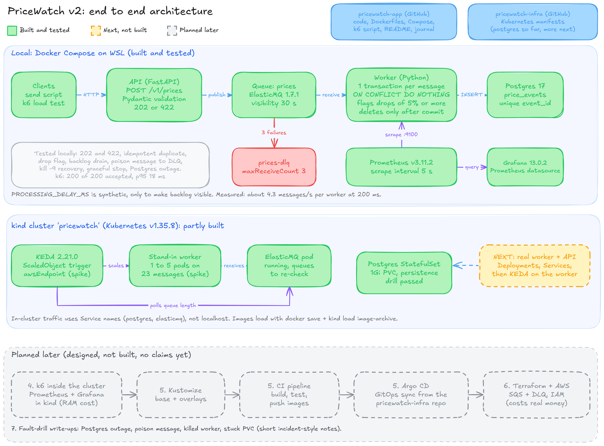
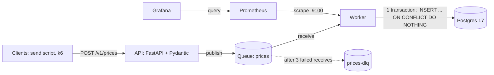

# PriceWatch

A learning project that follows commodity price events from an HTTP API, through a queue, into Postgres, and then scales the consumer with KEDA on Kubernetes.

It is built in small, tested steps. This README only claims what has been run and measured. Anything else is marked as next or planned.

> Related repo: [`pricewatch-infra`](https://github.com/Reich-imperial/pricewatch-infra) holds the Kubernetes manifests.

---

## Architecture




**Locally** the queue is ElasticMQ 1.7.1 (SQS compatible). On AWS later it becomes SQS, so the worker talks to the queue through a small adapter (`common/queue_adapter.py`).

### What happens to one message

1. A client sends `POST /v1/prices`. The API validates it with Pydantic and answers `202` (accepted) or `422` (rejected).
2. The API publishes the validated event to the `prices` queue. The API never waits for the database.
3. The worker receives one message, validates it again, and writes it in **one transaction**: it looks up the previous price for the symbol, then inserts with `ON CONFLICT (event_id) DO NOTHING`.
4. If the new price is 5% or more below the previous one, the row is flagged as a drop.
5. Only **after the commit** does the worker delete the message from the queue.

### Message format

```json
{
  "schema_version": 1,
  "event_id": "7a1c2f0e-0b0e-4e5d-9a55-3c1f2f6f9a10",
  "symbol": "RICE_50KG",
  "price_ngn": 92000,
  "observed_at": "2026-10-30T06:14:33Z",
  "source": "manual"
}
```

- `symbol` must be one of `RICE_50KG`, `BEANS_50KG`, `GARRI_50KG`, `TOMATO_BASKET`, `PALM_OIL_25L`.
- `price_ngn` is a strict integer from 1 to 10,000,000. A value such as `85200.5` or `"85200"` is rejected.
- The client creates `event_id`. Sending the same `event_id` twice results in one row.

---

## Status

| Area | Status | Evidence |
|---|---|---|
| Validation models | Done, tested | 9 unit tests pass |
| API (`202` / `422`) | Done, tested | local runs |
| Worker: idempotent insert, drop flag | Done, tested | duplicate event leaves one row; drop is flagged |
| Failure handling | Done, tested | see [Failure tests](#failure-tests) |
| Container images | Done, tested | both build; the worker container inserted a row with no local worker running |
| Docker Compose stack | Done, tested | ElasticMQ, Postgres, API, worker, Prometheus, Grafana |
| Worker metrics and Prometheus scrape | Done, tested | counter visible; Prometheus `up` is `1` for the worker |
| Grafana | Partly tested | datasource health check returned OK; the dashboard panel has not been verified yet |
| k6 load test | First run done | see [Load test](#load-test) |
| kind: KEDA scaling spike | Done, tested | stand-in worker scaled 1 to 5 pods on 23 messages |
| kind: Postgres with storage | Done, tested | row survived deleting the pod |
| kind: real worker and API | **Next** | not built |
| KEDA on the real worker | **Next** | not built |
| Kustomize, CI, Argo CD | Planned | not started |
| Terraform and AWS (SQS, DLQ, IAM) | Planned | not started; this part costs money |
| Fault-drill write-ups | Planned | not started |

---

## Run it locally

Requirements: Docker, and the Python 3.12 virtual environment in `.venv` for the helpers and tests.

```bash
cd dev
docker compose up -d --build     # ElasticMQ, Postgres, API, worker, Prometheus, Grafana
source helpers.sh                # adds: send, pg, qa, qn and the queue URL variables
send RICE_50KG 92000             # prints 202
pg "select symbol, price_ngn, is_drop from price_events order by processed_at desc limit 5"
```

Slow the worker on purpose so a backlog becomes visible (the delay is synthetic):

```bash
PROCESSING_DELAY_MS=200 docker compose up -d worker
docker compose exec worker printenv PROCESSING_DELAY_MS   # confirm it took effect
```

Before trusting a test, check that the thing you meant to test actually ran. A leftover local worker once processed messages that a container was supposed to handle.

Unit tests:

```bash
python -m pytest tests/
```

| Service | URL |
|---|---|
| API | http://localhost:8000 |
| Worker metrics | http://localhost:9100/metrics |
| Prometheus | http://localhost:9090 |
| Grafana | http://localhost:3000 (local login `admin` / `admin`, never expose this port) |

### Worker configuration

| Variable | Purpose |
|---|---|
| `QUEUE_URL` | Queue to consume |
| `SQS_ENDPOINT_URL` | Queue endpoint (ElasticMQ locally) |
| `AWS_REGION` | Region value used by the SQS client |
| `DATABASE_URL` | Postgres connection string |
| `PROCESSING_DELAY_MS` | Synthetic delay per message, default `0` |
| `DROP_THRESHOLD_PCT` | Drop threshold, default `5.0` |
| `WORKER_BACKOFF_SECONDS` | Pause after an error, default `5` |

---

## Design decisions

- **Delivery is at least once, writes are idempotent.** The queue may deliver a message twice, so `event_id` is unique and the insert uses `ON CONFLICT DO NOTHING`.
- **Delete after commit.** A crash between the insert and the delete causes a redelivery, which the idempotent insert absorbs. The reverse order could lose data.
- **Poison messages are not deleted.** An invalid message is left on the queue. After 3 receives it moves to `prices-dlq` (`maxReceiveCount 3`, visibility timeout 30 s).
- **One message per receive.** `receive` defaults to `max_messages=1`, so one bad message cannot hold up others in the same batch. This is from reading the code, not from a test. Raising the batch size would change that and needs a new test.
- **The API never touches the database.** It only validates and publishes, so it stays fast when the worker is slow.

---

## Failure tests

All passed locally in Docker Compose.

| Scenario | Result |
|---|---|
| Poison message | Moved to the DLQ after 3 receives |
| `kill -9` on the worker mid-message | Message reappeared after the visibility timeout and was processed |
| Graceful stop (SIGTERM) | Worker finished the current message first |
| Postgres outage | Worker backed off and recovered; exactly 1 row |

---

## Load test

Script: `dev/k6/load.js` (10 requests per second for 20 seconds, random valid prices). It runs as a throwaway container on the Compose network:

```bash
cd dev
docker run --rm -i --network dev_default -e BASE_URL=http://api:8000 -e RUN_ID=r1 \
  grafana/k6 run - < k6/load.js
```

Results from a run with the worker delay set to 200 ms:

| Measurement | Value |
|---|---|
| Requests accepted | 200 of 200 returned `202` |
| API latency | p95 18 ms (threshold was 500 ms) |
| Worker speed (from database timestamps) | about 4.2 to 4.4 messages per second per worker |
| Queue after the run | drained to empty |

The API stayed fast while the worker was slow, which is the reason for putting a queue in the middle.

---

## Kubernetes (kind)

Cluster `pricewatch` on kind, Kubernetes v1.35.8, KEDA 2.21.0.

- **Spike:** a KEDA `awsEndpoint` trigger scaled a stand-in worker from 1 to 5 pods on 23 messages, then back to 1 after about 5 minutes.
- **Postgres:** a StatefulSet with a 1Gi PersistentVolumeClaim. Persistence drill: inserted a row, deleted the pod, the row was still there.
- **Next:** load the real worker and API images, point them at the in-cluster `postgres` and `elasticmq` Services, then add a KEDA `ScaledObject` for the real worker.

Manifests live in [`pricewatch-infra`](https://github.com/Reich-imperial/pricewatch-infra).

---

## Repository layout

```text
.
├── api/main.py                  FastAPI service
├── worker/main.py               queue consumer
├── common/
│   ├── models.py                Pydantic models
│   └── queue_adapter.py         SQS-compatible queue wrapper
├── tests/test_models.py         unit tests (9)
├── Dockerfile.api
├── Dockerfile.worker
├── requirements-api.txt
├── requirements-worker.txt
├── dev/
│   ├── docker-compose.yaml
│   ├── elasticmq.conf
│   ├── init.sql                 database schema
│   ├── helpers.sh               send, pg, qa, qn
│   ├── prometheus.yml
│   ├── grafana/provisioning/    Prometheus datasource
│   └── k6/load.js
├── JOURNAL.md                   what was tried, what broke, what I learned
└── README.md
```

---

## Known gaps

- One of two k6 batches contains 201 rows, not 200. The cause has not been found. New runs are tagged with `RUN_ID` in the `source` field so this can be traced.
- The Grafana dashboard is not yet exported to a file, so it would not survive a fresh setup.
- The queue depth is only visible through a helper script. It is not exported to Prometheus.
- Credentials in Compose and the kind setup are for local development only.
- ElasticMQ in kind restarted once and its queues were not re-checked afterwards.

## Roadmap

1. Real worker and API in kind, then KEDA on the real worker.
2. k6, Prometheus and Grafana against the cluster (watch the RAM cost on WSL).
3. Kustomize, CI that builds and tests images, Argo CD syncing from `pricewatch-infra`.
4. Terraform and AWS: SQS with a DLQ, IAM, then the real queue in place of ElasticMQ.
5. Short incident-style write-ups for each fault drill: symptom, evidence, root cause, fix, prevention.
